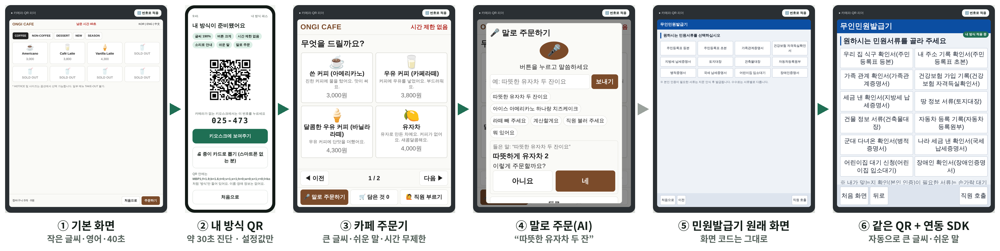

# 내 방식 패스 (MyWay Pass)

**키오스크가 나에게 맞춰집니다.** 2026 AI 라이프 솔루션 챌린지 출품작
(바탕 아이디어: 수상 후보작 「내 방식 QR : 범용 접근성 프로필 패스」)



휴대폰에서 30초 진단으로 ‘내 방식’(글씨 크기, 버튼 크기, 시간 제한, 소리 안내, 쉬운 말, 진한 화면, 휠체어 배치, 화면 낭독, 말로 주문, 언어)을 만들고, **QR 또는 6자리 번호**를 키오스크에 보여주면 화면이 그 사람에게 맞게 바뀝니다. QR에는 이름·연락처·장애 정보가 없고, 키오스크는 주문이 끝나면 이를 지웁니다.

## 바로 해 보기

- `index.html` 하나만 열면 됩니다(인터넷 서버 불필요, 글꼴만 온라인에서 받음). 크롬을 권장합니다. 음성 인식은 크롬의 브라우저 기능을 씁니다.
- 첫 화면의 **▶ 1분 자동 시연 보기**를 누르면 전체 흐름이 자동으로 재생됩니다.
- 왼쪽 휴대폰에서 예시(78세 어르신, 시각장애인, 휠체어 이용자, 외국인 노동자)를 고르거나 ‘내 방식 만들기’로 직접 진단합니다.
- 오른쪽 키오스크는 두 종류입니다.
  - ☕ **카페 주문기**: ‘내 방식’에 맞춰 설계한 화면으로, 말로 주문할 수 있습니다.
  - 🏛 **무인 민원발급기**(시연용 모형 웹 화면): 화면 코드는 그대로 두고 연동 도구(SDK)만 붙였습니다.

## 구성

| 경로 | 내용 |
|---|---|
| `index.html` | 배포용 단일 파일 (아래 파일들을 하나로 묶은 것) |
| `src/app.html` | 시제품 화면: 휴대폰, 카페 주문기, 민원발급기, AI 확인 패널, 시험 기록 |
| `src/mbp-sdk.js` | **연동 도구(SDK)**: 웹 화면 키오스크를 프로필대로 변환하고, 6자리 번호와 입력판을 제공. 전용 앱(윈도우·안드로이드)형 키오스크는 제조사 SDK 탑재나 안드로이드 접근성 서비스 연동이 필요 |
| `build/ai.js` | 음성주문 이해 엔진(`nlu/nlu.js`)에 학습된 모델과 메뉴 별칭을 합친 파일 |
| `build/qr.js` | QR 생성 라이브러리 (QRCode for JavaScript, © Kazuhiko Arase, MIT License) |
| `nlu/` | 학습 데이터 생성, 특징 계산, 학습, 평가 스크립트와 평가 문장 |
| `tests/` | Playwright 자동 시험(`test*.js`)과 시연 영상 녹화 스크립트(`rec.js`) |
| `build.py` | `src`와 `build`를 묶어 `index.html`(`out/`)을 만드는 스크립트 |

## AI 구성

1. **온디바이스 한국어 음성주문 이해** (`nlu/nlu.js`)
   - 흐름: 브라우저 음성인식 → 글자 1~3그램 + 띄어쓰기 없는 2그램을 FNV-1a로 4,096차원에 해시(L2 정규화) → **다항 로지스틱 회귀**로 9가지 의도 분류
   - 9가지 의도: 주문, 빼기, 계산, 전부 취소, 도움 요청, 다시 말해 달라, 네, 아니요, 메뉴 문의
   - 메뉴 찾기는 2단계입니다. 먼저 정확히 일치하는 말을 찾고, 그다음 **자모 단위 편집거리**로 비슷한 말을 찾습니다(‘아메리카로’, ‘까페라떼’ 같은 음성인식 오류 허용).
   - 연결어(이랑/하고/그리고)로 문장을 나눠 메뉴별 수량·온도를 뽑고, 부정(‘안 차가운 거’)도 처리합니다.
   - 메뉴를 못 찾으면 `NLU.suggest`가 소리가 가장 비슷한 메뉴로 “혹시 ○○ 말씀이세요?”라고 되묻습니다.
   - 모델 크기는 약 0.2MB이고, 문장 이해는 서버 없이 기기 안에서 계산합니다(음성→글자 변환 단계는 아래 개인정보 항목 참고).
2. **망설임 감지**(AI 모델이 아닌 규칙 기반 점수): 멈춘 시간, 버튼 옆 빗나간 터치, 뒤로 가기·닫기 반복, 남은 시간을 합친 점수입니다(현재는 규칙 기반, 실사용 기록이 쌓이면 학습 모델로 교체할 자리). 점수가 1을 넘으면 키오스크가 먼저 도움을 제안합니다.
3. **적응 제안**: ‘내 방식’ 화면에서도 빗나간 터치가 반복되면 버튼 확대를 제안하고, 그 결과를 프로필에 반영합니다.
4. **쉬운 말 사전과 다국어 메뉴명**: 생성형 AI로 초안을 만들고 사람이 검수했습니다(실행 중 생성하지 않음).

### 다시 학습하기

```bash
cd nlu
python gen.py && python gen2.py      # 학습 문장 생성 → train2.jsonl (14,000문장)
node feat.js train2                  # 브라우저 엔진과 같은 방식으로 특징 계산
python train.py train2 model.json    # scikit-learn LogisticRegression(C=6)
node eval.js test.jsonl handtest.jsonl blindtest3.jsonl
```

## 평가 결과 (있는 그대로)

`node eval.js 평가파일.jsonl` 은 전체 문장과 **학습 문장(`train2.jsonl`)과 똑같은 문장을 뺀 결과**를 함께 보여 줍니다. 보고서에는 겹치는 문장을 뺀 숫자를 씁니다.

| 평가 문장 (학습 문장과 겹치는 것 제외) | 문장 수 | 의도 정확도 | 완전 일치* | 주문 문장만 완전 일치 |
|---|---|---|---|---|
| `test.jsonl` 음성인식 오류를 섞은 합성 문장 (1,500개 중 535개가 학습 문장과 겹쳐 제외) | 965 | 99.6% | 90.6% | 88.2% (726개) |
| **`blindtest3.jsonl` 모델 고정 후 새로 쓴 문장, 사투리 포함 (최종)** (60개 중 짧은 말 10개 제외) | 50 | **98.0%** | **92.0%** | 88.0% (25개) |

\* 완전 일치: 의도·메뉴·수량·온도가 모두 맞은 비율(네·아니요처럼 메뉴가 없는 말도 포함). ‘주문 문장만’은 메뉴가 들어간 주문 문장 기준입니다.

참고(개발 중 조정에 쓴 문장이라 성능 지표로 쓰지 않음): `handtest.jsonl` 70개 100%, `blindtest.jsonl` 50개(처음 측정 완전 일치 82.0% → 데이터 보강 후 98.0%), `blindtest2.jsonl` 40개(처음 97.5% → 메뉴 찾기 수정 후 100%).

- 최종 평가에서 틀린 문장: ‘뜨신 유자차’, ‘따신 생강차’(사투리 온도 표현), ‘스무디 두 컵’(단위 ‘컵’), ‘제일 잘 나가는 게 뭐예요’(메뉴 문의를 주문으로 오인). 결과를 부풀리지 않도록 이 실패들은 고치지 않고 남겨 두었습니다.
- 최종 평가 뒤에 외부 검토에서 나온 줄임말(아아·뜨아·따아), ‘열 잔’, 정정 표현(“라떼 말고 아메리카노”, “세 개 아니 두 개”, “따뜻한 거 말고 차가운”) 처리를 더했습니다. 이 추가 뒤에도 위 숫자는 그대로입니다.
- 한계: 평가 문장은 모두 개발자가 작성했습니다. 다음 단계로 실제 어르신 음성을 모아 재평가합니다.

## 연동 도구(SDK) 사용법

```html
<script src="mbp-sdk.js"></script>
<script>
  MBP.attach(document.querySelector('#kiosk-root'), {
    onTimeLimit: factor => myTimer.scale(factor)   // Infinity = 시간 제한 없음
  });
  qrReader.onRead = text => MBP.applyQR(text);     // 'MBP1;f=1.9;b=1.6;t=0;...'
  numberButton.onclick = () => MBP.openKeypad(root, p => MBP.apply(p));  // 6자리 번호
  // 화면을 다시 그린 뒤: MBP.refresh()   주문이 끝나면: MBP.reset()
</script>
```

- 프로필 형식은 `MBP1;f=글씨배율;b=버튼배율;t=시간(0=없음);v=소리;e=쉬운말;h=진한화면;w=휠체어;s=말로주문;r=화면낭독;l=언어`입니다.
- 6자리 번호는 15비트 프로필 + Damm 검사 숫자 1자리입니다. 가능한 모든 번호에 대해 한 자리 오타와 이웃한 두 자리 바뀜을 모두 걸러내는 것을 전수 확인했습니다.

## 개인정보

- 이름, 연락처, 생년월일, 장애 여부는 받지 않습니다. 설정값만 담습니다.
- 다만 설정값(화면 낭독, 휠체어 배치)만으로도 장애를 짐작할 수 있으므로, 키오스크는 이를 저장하거나 보내지 않고 주문이 끝나면 바로 지웁니다.
- 휴대폰에는 프로필이 브라우저 저장소에만 남습니다. 키오스크는 주문이 끝나면 지웁니다.
- 주문 문장 이해(의도·메뉴·수량·온도)는 기기 안에서만 계산합니다.
- 주의: 시제품의 음성→글자 변환은 브라우저 음성인식(Web Speech API)을 씁니다. 크롬에서는 이 단계의 음성이 구글 서버로 전송됩니다. 실제 키오스크에서는 온디바이스 음성인식 엔진으로 바꿔 끼울 수 있도록 입력부를 분리해 두었습니다.

## 생성형 AI 활용 고지

- 쉬운 말 사전, 다국어 메뉴명, 일부 코드와 문서 작성에 생성형 AI를 보조 도구로 썼습니다.
- 설계, 판단, 검수, 시험은 개발자가 했습니다.
- 음성주문 이해 모델은 생성형 AI 모델이 아니라, 이 저장소의 스크립트로 직접 학습한 분류기입니다.
